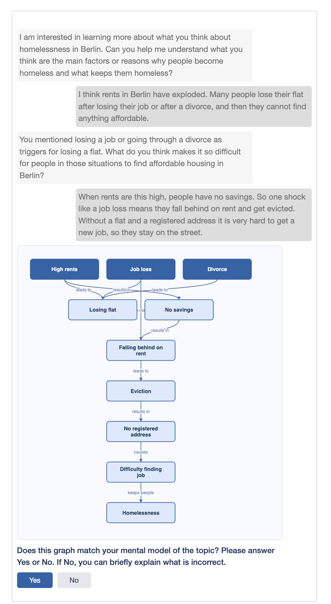

# LLM Behavioral Interviewer für Qualtrics

[English](README.md) · **Deutsch** · Stand: 18.11.2026

Ein Interviewer auf Basis großer Sprachmodelle (LLMs), der qualitative Interviews direkt in deiner Qualtrics-Umfrage führt. Er stellt eine Einstiegsfrage, fragt zu den Antworten nach, geht die von dir festgelegten Themen durch und kann die Ursache-Wirkungs-Vorstellungen der Befragten als Graph (DAG) zeichnen und bestätigen lassen.

Gedacht für Forschende ohne Programmierkenntnisse:

- **Kein Server.** Läuft im kostenlosen Tarif von Cloudflare.
- **Kein Terminal.** Einrichtung mit einem Button, Interviews bearbeitest du auf github.com.
- **Deine Daten bleiben bei dir.** Die Transkripte landen in deinen Qualtrics-Daten und in einer Sicherungsdatenbank in deinem eigenen Cloudflare-Konto.
- **Freie Wahl des LLM.** OpenAI, Google Gemini oder Anthropic Claude.

Die Bildschirmfotos zeigen die englische Oberfläche von Cloudflare und Qualtrics. Die Schaltflächen sind in der Anleitung so benannt, wie sie dort heißen.

## Einrichtung in etwa 30 Minuten

| Schritt | Was du tust | Zeit |
|---|---|---|
| [1. Was du brauchst](docs/de/1-was-du-brauchst.md) | Konten anlegen und einen API-Schlüssel holen. | 15 Min. |
| [2. Online stellen](docs/de/2-online-stellen.md) | Button unten klicken, GitHub verbinden, Schlüssel einfügen. | 5 Min. |
| [3. Testen](docs/de/3-testen.md) | Das Beispielinterview im Browser ausprobieren. | 2 Min. |
| [4. Eigenes Interview](docs/de/4-eigenes-interview.md) | Vorlage kopieren und eigene Fragen schreiben. | beliebig |
| [5. Qualtrics](docs/de/5-qualtrics.md) | Umfragedatei importieren und Adresse eintragen. | 5 Min. |
| [6. Deine Daten](docs/de/6-daten.md) | Transkripte finden und exportieren. | |
| [7. Hilfe](docs/de/7-hilfe.md) | Kosten, Datenschutz, Schlüssel wechseln, Probleme. | |

Lies [Kapitel 1](docs/de/1-was-du-brauchst.md), bevor du klickst.

## Beispielinterviews

| ID | Thema |
|---|---|
| `STOCK_MARKET` | Warum Menschen nicht in Aktien investieren. Die Konfiguration aus Chopra & Haaland (2023). |
| `HOMELESS_BERLIN` | Was Menschen für die Ursachen von Obdachlosigkeit in Berlin halten. Zeichnet nach jedem Thema einen Ursache-Wirkungs-Graphen. |

Beide Beispiele sind auf Englisch. Die Texte eines eigenen Interviews kannst du in jeder Sprache schreiben. Einige feste Texte sind auf Englisch: die Buttons im Chat und die Frage, ob der Graph stimmt.

## Für Entwickler

[How it works](docs/en/how-it-works.md) (nur auf Englisch) beschreibt Architektur, lokale Entwicklung und Tests.

## Grundlage

Dieses Projekt baut auf folgender Arbeit auf:

> Chopra, Felix and Haaland, Ingar, *Conducting Qualitative Interviews with AI* (2023). CESifo Working Paper No. 10666. SSRN: <https://ssrn.com/abstract=4583756>

Der ursprüngliche Code steht unter [CC BY-NC 4.0](https://creativecommons.org/licenses/by-nc/4.0/). Bei Nutzung und Weitergabe bitte das Paper zitieren (BibTeX im [englischen README](README.md#building-on-prior-work)).
