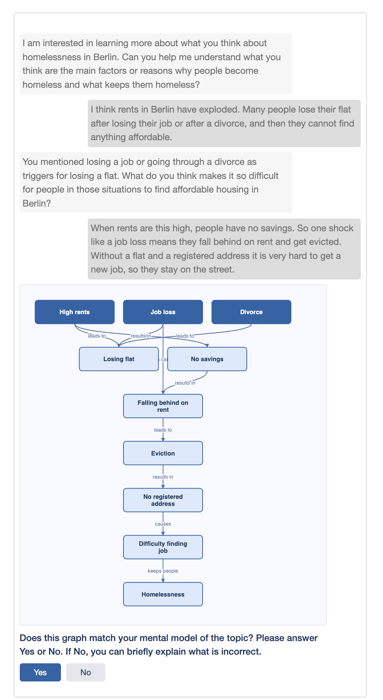

# LLM Behavioral Interviewer for Qualtrics

**English** · [Deutsch](README.de.md)

An interviewer based on large language models (LLMs) that runs qualitative interviews inside your Qualtrics survey. It asks an opening question, follows up on what the respondent says, moves through the topics you define, and can draw each respondent's cause-and-effect reasoning as a graph (a DAG) and ask them to confirm it.

It is built for researchers without a programming background:

- **No server.** It runs on Cloudflare's free plan.
- **No terminal.** You set it up with one button and edit interviews on github.com.
- **Your data stays with you.** Transcripts go into your Qualtrics data and a backup database in your own Cloudflare account.
- **Choose your LLM.** OpenAI, Google Gemini or Anthropic Claude.



## Set it up in about 30 minutes

| Step | What you do | Time |
|---|---|---|
| [1. What you need](docs/en/1-what-you-need.md) | Create the accounts and one API key. | 15 min |
| [2. Deploy](docs/en/2-deploy.md) | Click the button below, connect GitHub, paste the key. | 5 min |
| [3. Test](docs/en/3-test.md) | Try the example interview in your browser. | 2 min |
| [4. Your own interview](docs/en/4-own-interview.md) | Copy the template and write your questions. | as long as you like |
| [5. Qualtrics](docs/en/5-qualtrics.md) | Import the survey file and enter your address. | 5 min |
| [6. Your data](docs/en/6-data.md) | Find the transcripts and export them. | |
| [7. Help](docs/en/7-help.md) | Costs, privacy, changing keys, problems. | |

[](https://deploy.workers.cloudflare.com/?url=https://github.com/brandesdavid/llm-behavioral-interviewer)

Read [chapter 1](docs/en/1-what-you-need.md) before you click.

## Example interviews

| ID | Topic |
|---|---|
| `STOCK_MARKET` | Why people do not invest in the stock market. The configuration from Chopra & Haaland (2023). |
| `HOMELESS_BERLIN` | What people believe causes homelessness in Berlin and keeps people homeless. Draws a cause-and-effect graph after each topic. |

## For developers

[How it works](docs/en/how-it-works.md) covers the architecture, local development and tests.

## Building on prior work

This project builds on:

> Chopra, Felix and Haaland, Ingar, *Conducting Qualitative Interviews with AI* (2023). CESifo Working Paper No. 10666. Available at SSRN: <https://ssrn.com/abstract=4583756>

The original framework provides multi-topic interview plans, LLM probing and transition agents and answer moderation. This version adds the DAG agent, which turns each topic's answers into a causal graph, and runs the whole interviewer on Cloudflare Workers.

The original code is licensed under [CC BY-NC 4.0](https://creativecommons.org/licenses/by-nc/4.0/). Uses and distribution should cite the paper:

```bibtex
@article{ChopraHaaland2023,
  title={Conducting Qualitative Interviews with AI},
  author={Chopra, Felix and Haaland, Ingar},
  journal={CESifo Working Paper No. 10666},
  url={https://ssrn.com/abstract=4583756},
  year={2023}
}
```
