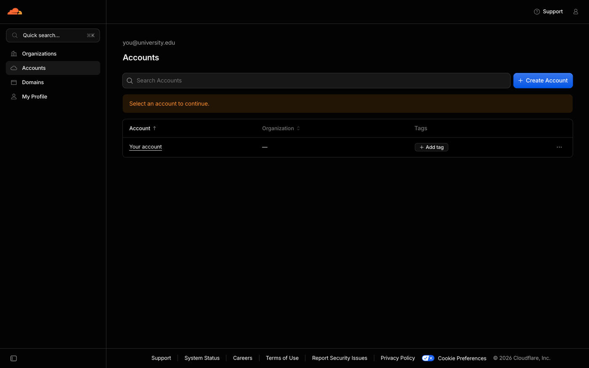
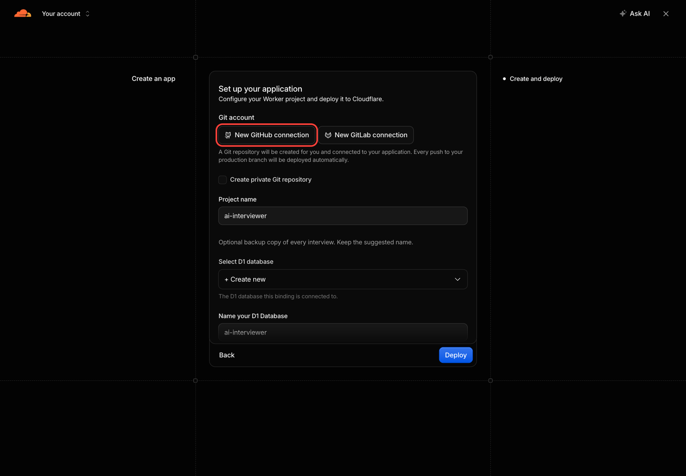
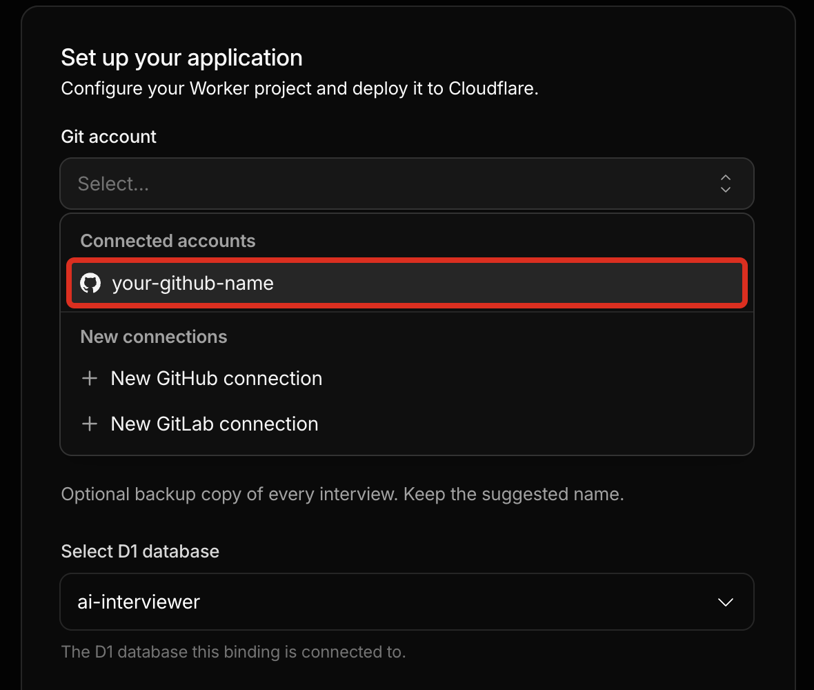
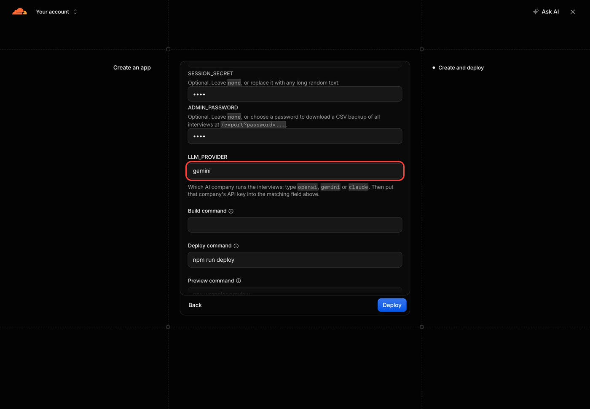
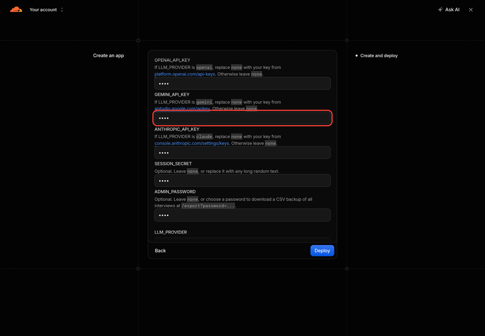
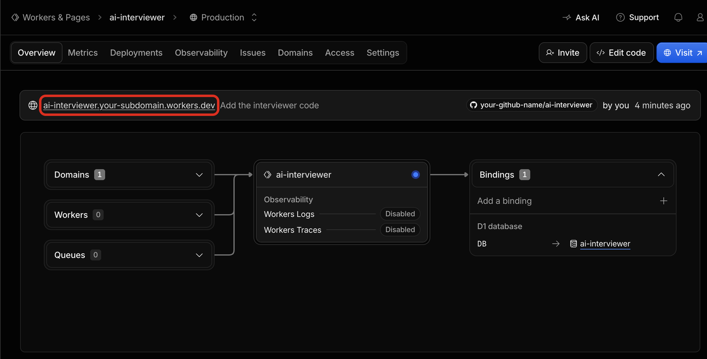
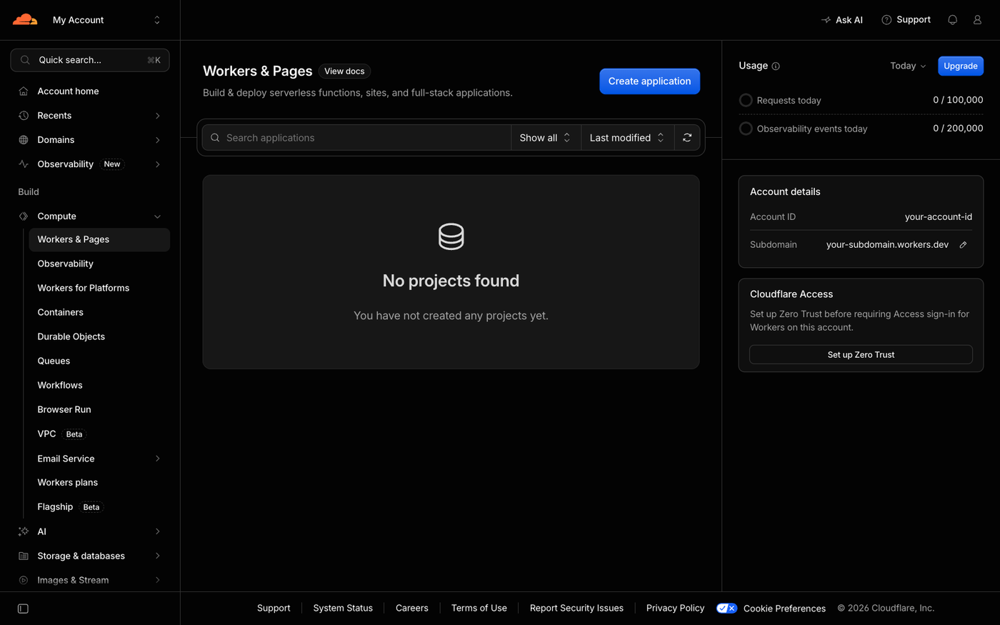

# 2. Den Interviewer online stellen

[← Was du brauchst](1-was-du-brauchst.md) · [Übersicht](../../README.de.md) · [Weiter: Testen →](3-testen.md) · Stand: 18.11.2026

Ein Button kopiert den Code in dein GitHub-Konto und startet ihn bei Cloudflare. Du brauchst kein Terminal.

## Schritt 1: Button klicken

[](https://deploy.workers.cloudflare.com/?url=https://github.com/brandesdavid/llm-behavioral-interviewer)

Melde dich bei Cloudflare an. Wenn du mehrere Cloudflare-Konten hast, wähle das gewünschte aus.



## Schritt 2: GitHub verbinden

Klicke unter **Git account** auf **New GitHub connection**.



GitHub öffnet sich und bittet dich, die App *Cloudflare Workers and Pages* zu installieren. Wähle **All repositories** und klicke auf **Install**. Cloudflare braucht das, um das neue Repository für dich anzulegen.

Zurück bei Cloudflare wählst du unter **Git account** deinen GitHub-Namen.



Optional: Setze ein Häkchen bei **Create private Git repository**, wenn andere deine Interviewtexte nicht sehen sollen.

Lass **Project name** und die Felder zur **D1 database** unverändert. Die Datenbank speichert eine Sicherungskopie jedes Interviews.

## Schritt 3: LLM-Anbieter wählen

Scrolle zu **LLM_PROVIDER**. Tippe `openai`, `gemini` oder `claude`, passend zu dem Schlüssel aus [Kapitel 1](1-was-du-brauchst.md).



## Schritt 4: API-Schlüssel einfügen

Jedes Geheimnis-Feld ist mit `none` vorausgefüllt. `none` bedeutet „wird nicht benutzt“.

Ersetze `none` **nur im Feld, das zu deinem Anbieter passt**, durch deinen Schlüssel:

| LLM_PROVIDER | Feld für den Schlüssel |
|---|---|
| `openai` | `OPENAI_API_KEY` |
| `gemini` | `GEMINI_API_KEY` |
| `claude` | `ANTHROPIC_API_KEY` |



Lass in den anderen Feldern `none` stehen. Zwei davon sind optional:

- `SESSION_SECRET`: `none` lassen. Der Interviewer erzeugt dann selbst einen.
- `ADMIN_PASSWORD`: Wähle ein Passwort, wenn du später alle Interviews als CSV-Datei aus der Sicherungsdatenbank herunterladen willst ([Kapitel 6](6-daten.md)). Du kannst es auch später ergänzen.

Klicke auf **Deploy**.

## Schritt 5: Warten und Adresse kopieren

Der erste Build dauert 2 bis 4 Minuten. Danach zeigt die Seite die Adresse deines Interviewers:

```
https://ai-interviewer.DEINE-SUBDOMAIN.workers.dev
```



Kopiere diese Adresse. Du brauchst sie für den Test und für Qualtrics.

## ✅ Das solltest du jetzt sehen

- Eine Erfolgsmeldung oder die Übersichtsseite oben.
- Wenn du die Adresse im Browser öffnest, steht dort `Running!`.
- Ein neues Repository namens `ai-interviewer` in deinem GitHub-Konto.

## Klappt nicht?

| Problem | Was du tun kannst |
|---|---|
| Cloudflare kann das Repository nicht anlegen | Öffne auf GitHub **Settings → Applications → Cloudflare Workers and Pages → Configure** und stelle **Repository access** auf **All repositories**. Starte dann noch einmal mit dem Button. |
| Der Build ist fehlgeschlagen | Öffne den Worker bei Cloudflare, Reiter **Deployments**, und öffne das Build-Log. Eine rote Zeile gegen Ende nennt das Problem. |
| Die Adresse ist weg | Cloudflare-Dashboard → **Workers & Pages** → **ai-interviewer**. Die Adresse steht oben. Deine Subdomain steht auch rechts auf der Seite **Workers & Pages**. |



[Weiter: Interview testen →](3-testen.md)
