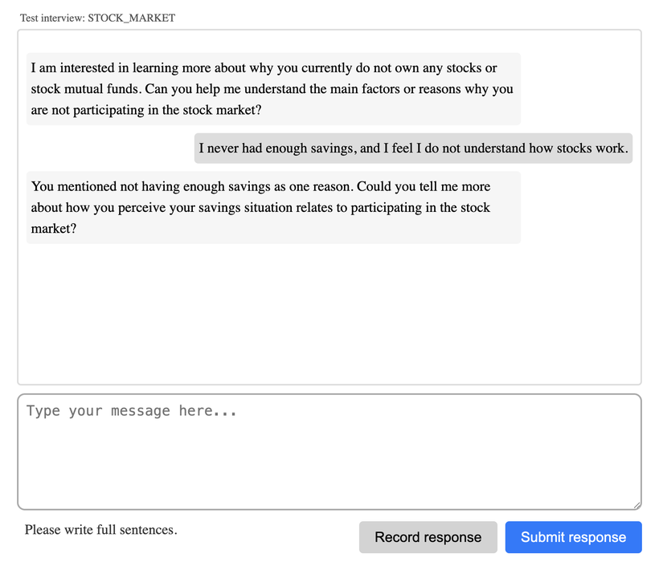

# 3. Ein Interview im Browser testen

[← Online stellen](2-online-stellen.md) · [Übersicht](../../README.de.md) · [Weiter: Eigenes Interview →](4-eigenes-interview.md) · Stand: 18.11.2026

Bevor du Qualtrics anfasst, prüfe, ob der Interviewer antwortet.

Öffne diese Adresse mit deiner eigenen Subdomain:

```
https://ai-interviewer.DEINE-SUBDOMAIN.workers.dev/test/STOCK_MARKET
```

`STOCK_MARKET` ist das Beispielinterview aus Chopra & Haaland (2023). Ein zweites Beispiel ist `HOMELESS_BERLIN`. Es zeichnet nach jedem Thema zusätzlich einen Ursache-Wirkungs-Graphen.

Tippe eine Antwort und klicke auf **Submit response**. Nach ein paar Sekunden erscheint eine Nachfrage.



Mit **Record response** kannst du per Sprache antworten. Das funktioniert nur mit `openai` oder `gemini`.

Alle Interviews, die dein Interviewer kennt, siehst du unter `/interviews`:

```
https://ai-interviewer.DEINE-SUBDOMAIN.workers.dev/interviews
```

## ✅ Das solltest du jetzt sehen

Eine Nachfrage, die sich auf deine Antwort bezieht.

## Klappt nicht?

| Meldung | Was du tun kannst |
|---|---|
| `rejected the API key (HTTP 401)` oder `(HTTP 403)` | Der Schlüssel ist falsch oder wurde gelöscht. Trage einen neuen ein ([Kapitel 7](7-hilfe.md#api-schlüssel-ändern-oder-erneuern)). |
| `Missing API key for provider ...` | Der Schlüssel steht im falschen Feld, oder `LLM_PROVIDER` nennt einen anderen Anbieter. |
| `request failed (HTTP 429)` | Das Anfragelimit oder dein Ausgabenlimit beim Anbieter ist erreicht. Prüfe die Abrechnung beim Anbieter. |
| `Unknown interview` | Der Name nach `/test/` muss genau einem Dateinamen in `src/interviews/` entsprechen, ohne `.toml`. Groß- und Kleinschreibung zählt. |

[Weiter: Eigenes Interview schreiben →](4-eigenes-interview.md)
