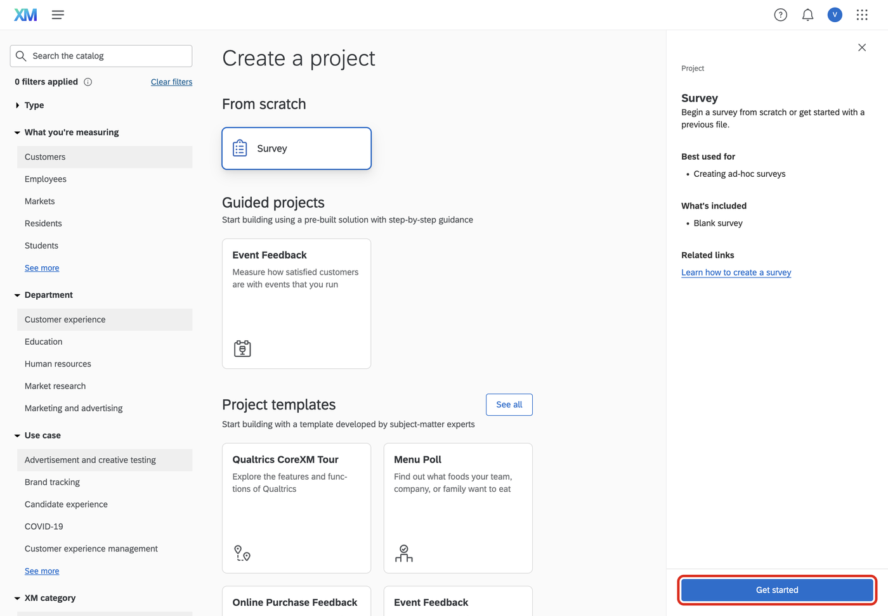
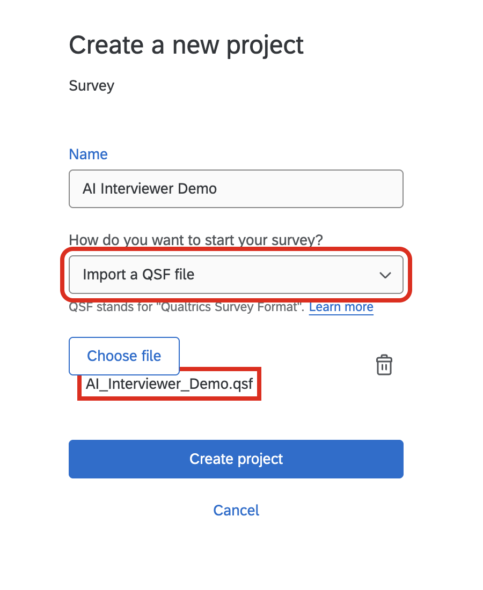
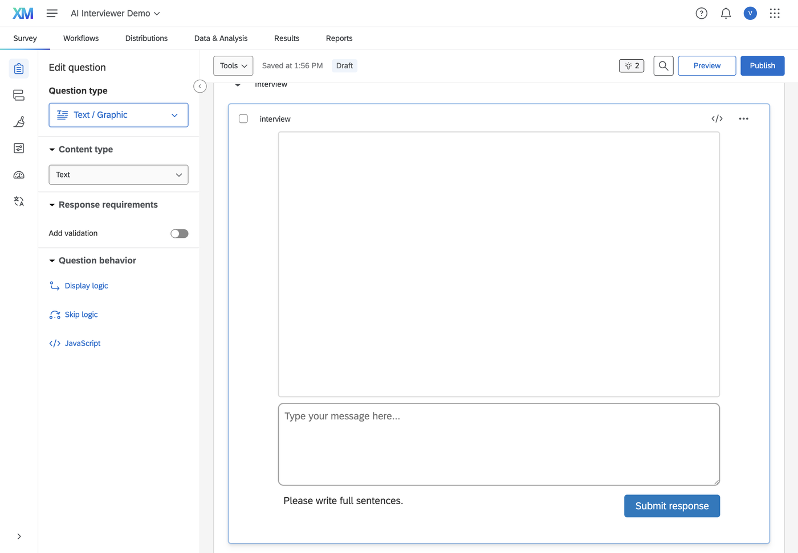
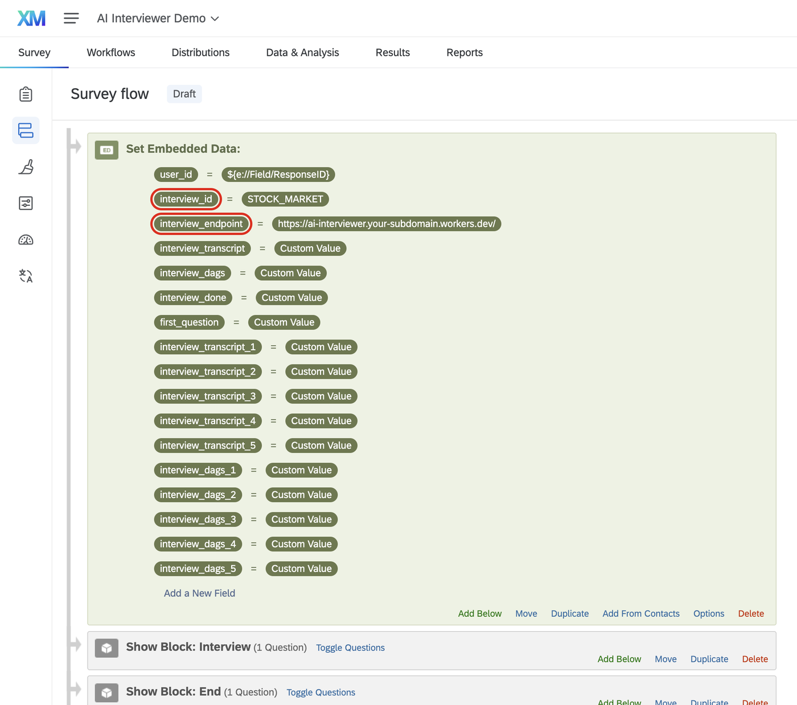
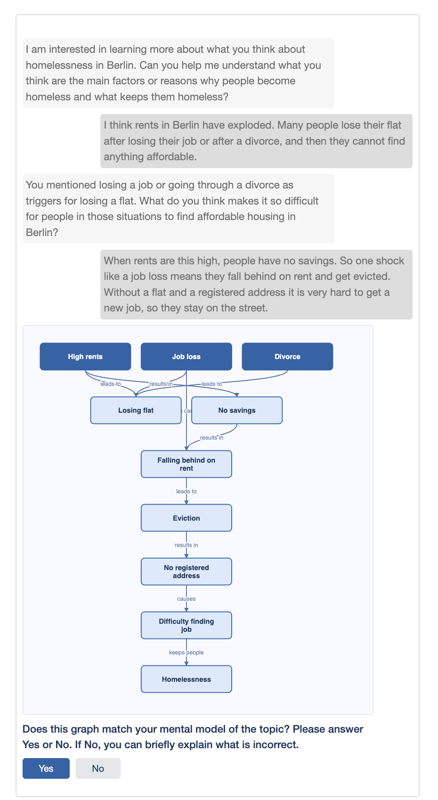

# 5. Das Interview in Qualtrics einbauen

[← Eigenes Interview](4-eigenes-interview.md) · [Übersicht](../../README.de.md) · [Weiter: Deine Daten →](6-daten.md) · Stand: 18.11.2026

Du importierst eine fertige Umfragedatei und änderst zwei Werte. Code kopieren musst du nicht.

## Schritt 1: Umfragedatei herunterladen

Öffne in deinem GitHub-Repository den Ordner `qualtrics/` und klicke auf eine dieser Dateien:

| Datei | Befragte antworten |
|---|---|
| `AI_Interviewer_Demo.qsf` | per Tastatur |
| `AI_Interviewer_Demo_voice.qsf` | per Tastatur oder Sprache (braucht `openai` oder `gemini`) |

Klicke auf den Button **Download raw file** (Pfeil nach unten, oben rechts über der Datei).

## Schritt 2: In Qualtrics importieren

1. Klicke in Qualtrics auf **Create a project**, wähle unter *From scratch* **Survey** und klicke auf **Get started**.

   

2. Gib der Umfrage einen Namen. Wähle unter **How do you want to start your survey?** die Option **Import a QSF file**, wähle die heruntergeladene Datei und klicke auf **Create project**.

   

Die Umfrage öffnet sich. Die Frage „interview“ sieht im Editor leer aus. Das ist normal: Der Chat erscheint erst, wenn die Umfrage läuft.

## Schritt 3: Die Umfrage mit deinem Interviewer verbinden

1. Klicke in der linken Leiste auf **Survey flow** (zweites Symbol).
2. Klicke im grünen Kasten **Set Embedded Data** auf den Wert hinter `interview_endpoint` und ersetze ihn durch deine Adresse aus [Kapitel 2](2-online-stellen.md), zum Beispiel `https://ai-interviewer.DEINE-SUBDOMAIN.workers.dev/`.
3. Klicke auf den Wert hinter `interview_id` und ersetze `STOCK_MARKET` durch die ID deines Interviews, zum Beispiel `MEINE_STUDIE`. Für einen ersten Versuch kannst du `STOCK_MARKET` lassen.
4. Klicke unten rechts auf **Apply**.

Lass alle anderen Felder im grünen Kasten unverändert. Der Interviewer schreibt seine Ergebnisse hinein.

## Schritt 4: Ausprobieren

Klicke oben im Editor auf **Preview** und beantworte die erste Frage.

Das Bild zeigt das Beispiel `HOMELESS_BERLIN`. Nach der letzten Frage eines Themas zeichnet der Interviewer das Gesagte als Ursache-Wirkungs-Graph und fragt, ob er stimmt. Mit **No** kann die Person eine Korrektur eintippen. Interviews ohne `[dag]`, etwa `STOCK_MARKET`, gehen direkt mit der nächsten Frage weiter.

## Schritt 5: Eigene Fragen ergänzen und veröffentlichen

- Füge deine übrigen Fragen in neuen Blöcken **vor oder nach** dem Block *Interview* ein. Ändere die Frage im Block *Interview* nicht.
- Der Weiter-Pfeil ist während des Interviews sichtbar. Wenn das Interview vorbei ist, steht auf dem Button im Chat **End of interview**. Bitte die Befragten in deinen Hinweisen, erst dann weiterzuklicken. Wer fertig wurde, siehst du später im Feld `interview_done` ([Kapitel 6](6-daten.md)).
- Wenn alles funktioniert, klicke auf **Publish**.

## ✅ Das solltest du jetzt sehen

In der Vorschau die erste Frage deines Interviews und nach deiner Antwort eine Nachfrage.

## Klappt nicht?

| Problem | Was du tun kannst |
|---|---|
| Das Chatfenster bleibt leer | Prüfe `interview_endpoint` im Survey flow. Es muss mit `https://` beginnen und genau deine Adresse sein. Öffne die Adresse im Browser: Dort muss `Running!` stehen. |
| Fehler „Unknown interview“ | `interview_id` im Survey flow muss genau einem Dateinamen in `src/interviews/` entsprechen. |
| „Create project“ scheitert beim Import | Lade die Datei noch einmal mit **Download raw file** herunter. Wenn du die Seite im Browser speicherst, entsteht eine Datei, die Qualtrics nicht lesen kann. |
| Deine Umfrage existiert schon, du willst nur das Interview darin | Importiere die Demo als eigenes Projekt und speichere ihren Block *Interview* in deiner Qualtrics-Bibliothek. Füge den Block aus der Bibliothek in deine Umfrage ein. Lege dann ganz oben in deinem Survey flow dieselben Embedded-Data-Felder an wie in der Demo. |

[Weiter: Deine Daten →](6-daten.md)
