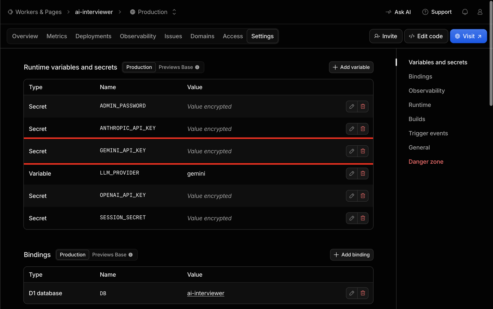

# 7. Hilfe und Fragen

[← Deine Daten](6-daten.md) · [Übersicht](../../README.de.md) · Stand: 18.11.2026

## Was kostet das?

- **Cloudflare**: im kostenlosen Tarif nichts. Er erlaubt 100.000 Anfragen pro Tag, jede Antwort ist eine Anfrage.
- **GitHub**: nichts.
- **LLM-Anbieter**: Du zahlst nach Verbrauch. Als grobe Orientierung kostet ein 15-minütiges Interview mit Gemini Flash-Lite deutlich unter einem Cent und mit GPT-4o etwa 10 bis 30 Cent. Längere Interviews und die `[dag]`-Graphen kosten mehr. Setze beim Anbieter ein monatliches Ausgabenlimit ([Kapitel 1](1-was-du-brauchst.md)).

## API-Schlüssel ändern oder erneuern

Das brauchst du, wenn jemand den Schlüssel gesehen hat, wenn er nicht mehr funktioniert oder wenn du `ADMIN_PASSWORD` ergänzen willst.

1. Cloudflare-Dashboard → **Workers & Pages** → **ai-interviewer** → **Settings** → **Variables and secrets**.
2. Klicke auf den Stift neben dem Geheimnis, füge den neuen Wert ein und speichere. Für ein neues Geheimnis klicke auf **Add variable** und wähle als Typ **Secret**.
3. Lösche den alten Schlüssel beim Anbieter.

Die Änderung gilt nach wenigen Sekunden. Geheimnisse bleiben erhalten, wenn du später Interviewdateien änderst.

Steht `SESSION_SECRET` auf `none`, beendet ein neuer API-Schlüssel auch die Interviews, die gerade laufen. Diese Personen müssen das Interview neu beginnen. Wechsle Schlüssel also, wenn niemand die Umfrage ausfüllt, oder setze `SESSION_SECRET` auf einen beliebigen langen Zufallstext.

## Zu einem anderen LLM-Anbieter wechseln

`LLM_PROVIDER` steht in der Datei `wrangler.jsonc` deines GitHub-Repositorys. Eine Änderung im Cloudflare-Dashboard würde beim nächsten Commit überschrieben.

1. Lege den Schlüssel des neuen Anbieters als Geheimnis an (siehe oben): `OPENAI_API_KEY`, `GEMINI_API_KEY` oder `ANTHROPIC_API_KEY`.
2. Öffne auf github.com die Datei `wrangler.jsonc`, klicke auf den Stift und ändere die Zeile `"LLM_PROVIDER": "..."` auf `openai`, `gemini` oder `claude`.
3. Speichere in den main-Branch. Nach 2 bis 4 Minuten ist die neue Version online.

Wenn deine Interviewdateien ein `model` setzen, ändere es auf ein Modell des neuen Anbieters oder lösche die Zeile.

## Datenschutz

- Antworten gehen vom Browser der Befragten an deinen Cloudflare-Worker und von dort an den LLM-Anbieter. Gespeichert werden sie in Qualtrics und in deiner Cloudflare-Datenbank. Die Autoren dieses Projekts bekommen nichts.
- Nenne den LLM-Anbieter in deiner Einwilligungserklärung und im Ethikantrag.
- Bitte die Befragten, keine Namen oder anderen identifizierenden Angaben zu tippen.
- Nutze beim LLM-Anbieter ein bezahltes Konto. Kostenlose Kontingente, zum Beispiel bei Gemini, dürfen deine Daten zur Verbesserung der Produkte des Anbieters nutzen.
- Um alle Sicherungsdaten zu löschen, lösche bei Cloudflare die D1-Datenbank `ai-interviewer`. Interviews laufen auch ohne sie; nur die Sicherung und `/export` fallen weg.

## Grenzen

- Gesprochene Antworten funktionieren nicht mit `claude`. Mit `openai` wird Sprache als Englisch erkannt.
- Einige feste Texte sind auf Englisch: die Buttons im Chat und die Frage, ob der Graph stimmt. Alles in deiner Interviewdatei kann in jeder Sprache sein.
- Ein Qualtrics-Feld fasst etwa 75.000 Zeichen Transkript (fünf Teile). Die Sicherungsdatenbank hat diese Grenze nicht.
- Eine Antwort darf bis zu 5.000 Zeichen lang sein.

## Neue Versionen dieses Projekts übernehmen

Dein Repository ist eine Kopie und ändert sich nicht von selbst. Für eine neuere Version kopierst du die geänderten Dateien aus [brandesdavid/llm-behavioral-interviewer](https://github.com/brandesdavid/llm-behavioral-interviewer) in dein Repository oder bittest jemanden mit Git-Erfahrung, sie zusammenzuführen. Behalte deine eigenen Dateien in `src/interviews/` und deine `wrangler.jsonc`.

## Immer noch nicht weiter?

Öffne den Worker bei Cloudflare, Reiter **Observability**, und wiederhole den Schritt, der scheitert. Das Log zeigt den Fehler des Workers. Füge diesen Text bei, wenn du im [Issue-Tracker](https://github.com/brandesdavid/llm-behavioral-interviewer/issues) um Hilfe bittest.
