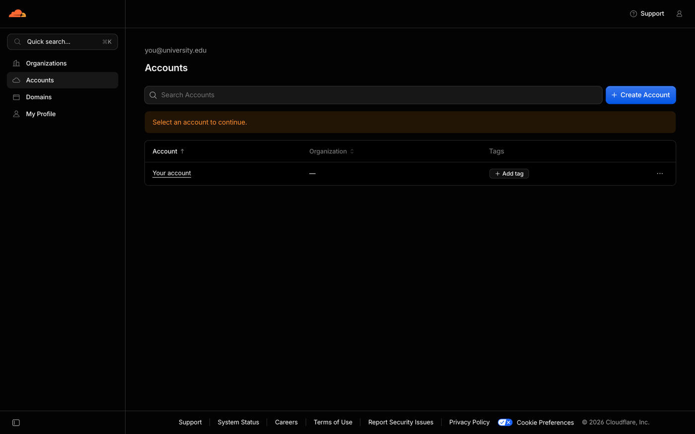
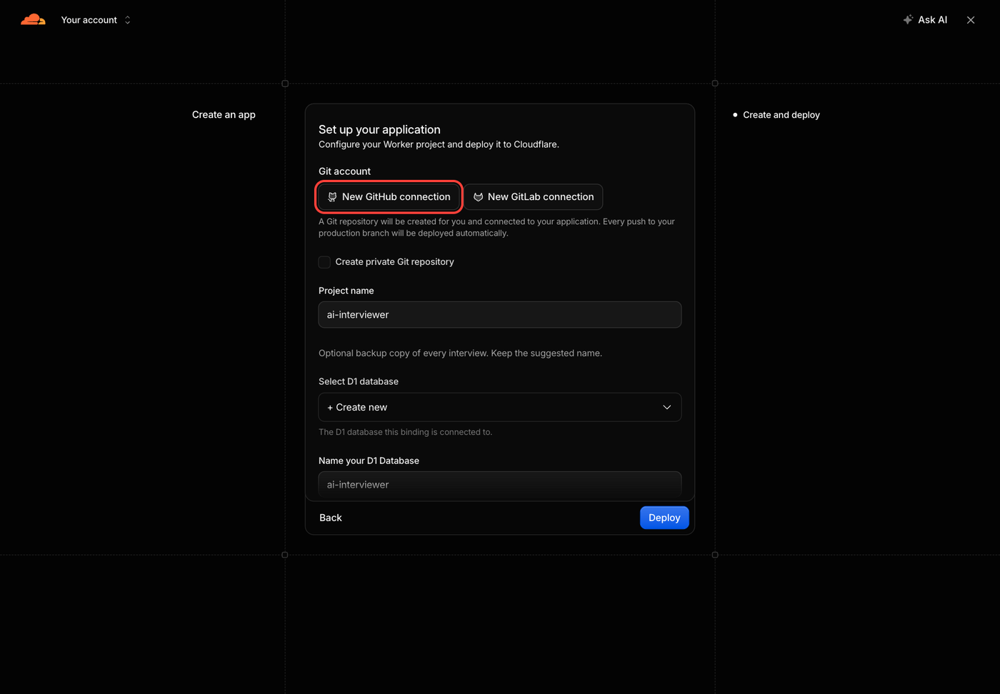
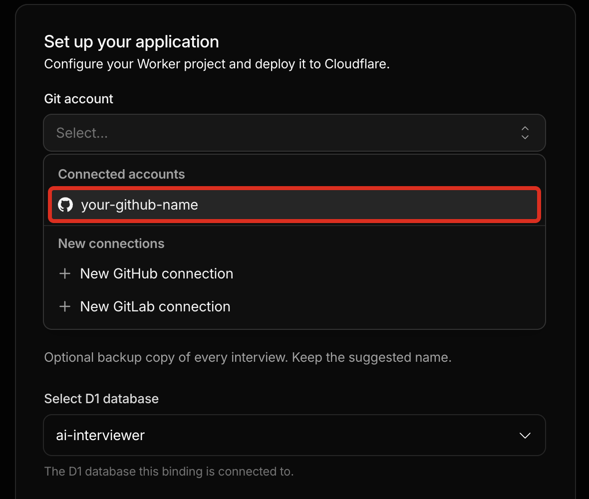
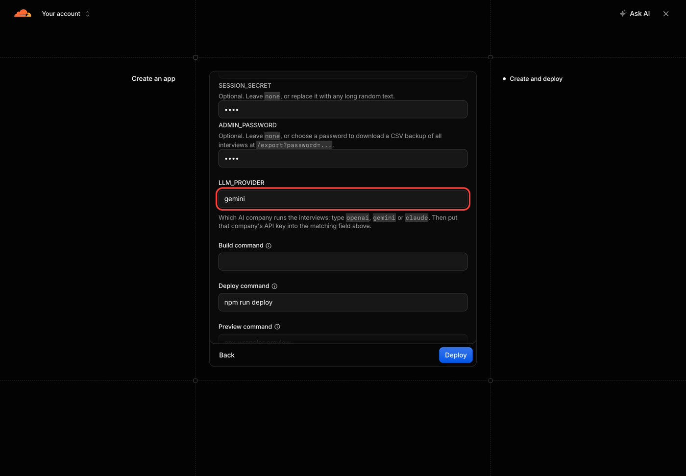
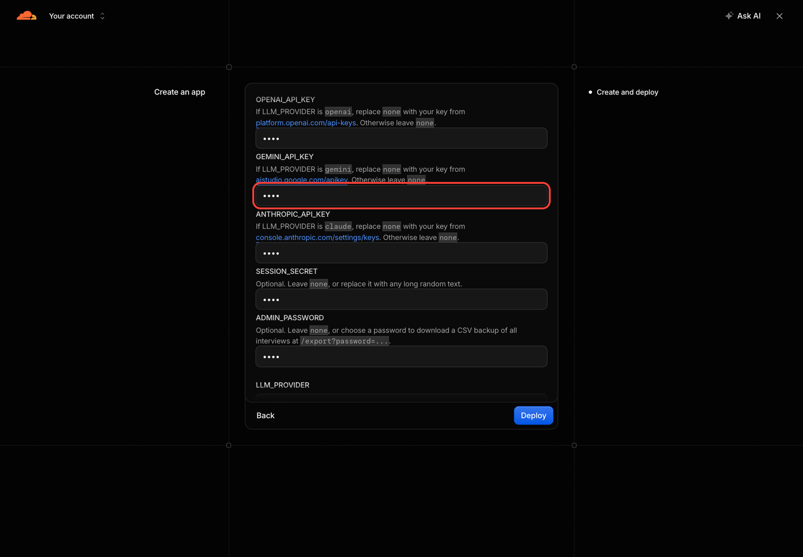
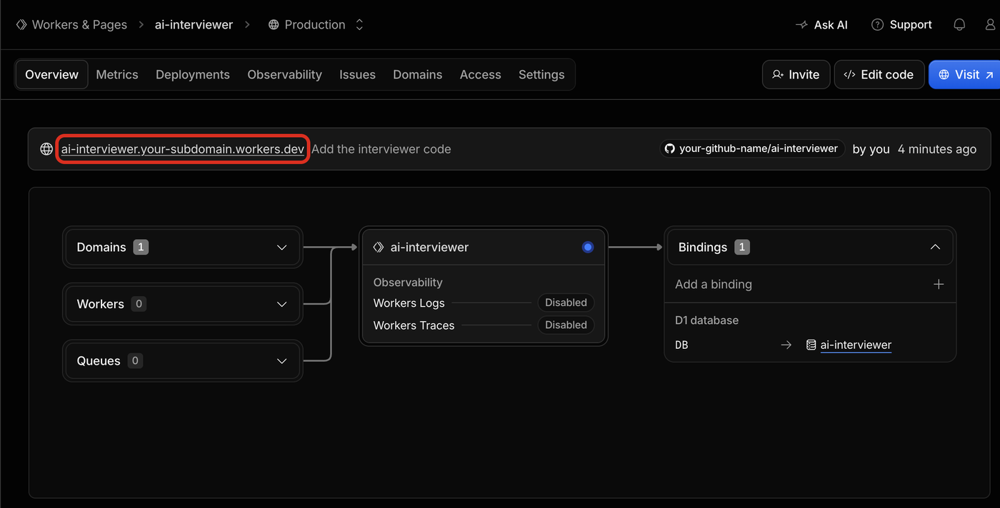
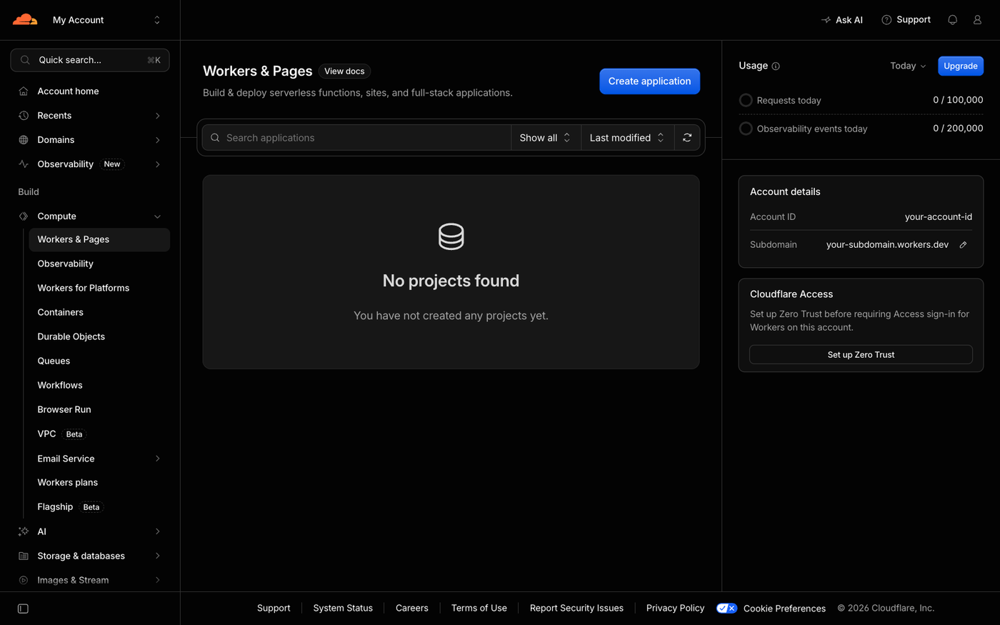

# 2. Put the interviewer online

[← What you need](1-what-you-need.md) · [Overview](../../README.md) · [Next: Test →](3-test.md)

One button copies the code into your GitHub account and starts it on Cloudflare. You do not need a terminal.

## Step 1: Click the button

[](https://deploy.workers.cloudflare.com/?url=https://github.com/brandesdavid/llm-behavioral-interviewer)

Log in to Cloudflare. If you have more than one Cloudflare account, pick the one you want to use.



## Step 2: Connect GitHub

Under **Git account**, click **New GitHub connection**.



GitHub opens and asks you to install the app *Cloudflare Workers and Pages*. Choose **All repositories** and click **Install**. Cloudflare needs this to create the new repository for you.

Back in Cloudflare, select your GitHub name under **Git account**.



Optional: tick **Create private Git repository** if other people should not see your interview texts.

Leave **Project name** and the **D1 database** fields as they are. The database keeps a backup copy of every interview.

## Step 3: Choose the LLM provider

Scroll down to **LLM_PROVIDER**. Type `openai`, `gemini` or `claude`, matching the key you created in [chapter 1](1-what-you-need.md).



## Step 4: Paste your API key

Every secret field is pre-filled with `none`. `none` means "not used".

Replace `none` with your key **only in the field that matches your provider**:

| LLM_PROVIDER | Field for the key |
|---|---|
| `openai` | `OPENAI_API_KEY` |
| `gemini` | `GEMINI_API_KEY` |
| `claude` | `ANTHROPIC_API_KEY` |



Leave the other fields as `none`. Two of them are optional:

- `SESSION_SECRET`: leave `none`. The interviewer then makes its own.
- `ADMIN_PASSWORD`: choose a password if you want to download all interviews as a CSV file from the backup database later ([chapter 6](6-data.md)). You can also add it later.

Click **Deploy**.

## Step 5: Wait and copy your address

The first build takes 2 to 4 minutes. Then the page shows your interviewer's address:

```
https://ai-interviewer.YOUR-SUBDOMAIN.workers.dev
```



Copy this address. You need it for the test and for Qualtrics.

## ✅ You should now see

- A green "Success" or the overview page above.
- When you open the address in a browser, the page says `Running!`.
- A new repository named `ai-interviewer` in your GitHub account.

## Something went wrong?

| Problem | What to do |
|---|---|
| Cloudflare cannot create the repository | On GitHub, open **Settings → Applications → Cloudflare Workers and Pages → Configure** and set **Repository access** to **All repositories**. Then start again with the button. |
| The build failed | Open the worker in Cloudflare, tab **Deployments**, and open the build log. A red line near the end names the problem. |
| You lost the address | Cloudflare dashboard → **Workers & Pages** → **ai-interviewer**. The address is at the top. Your subdomain is also shown on the right of the **Workers & Pages** page. |



[Next: Test the interview →](3-test.md)
