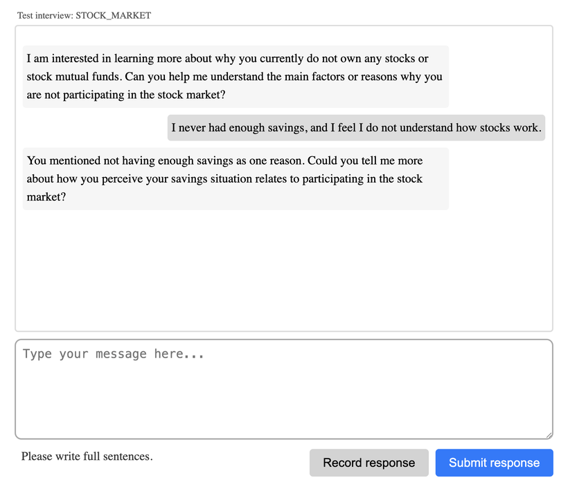

# 3. Test an interview in the browser

[← Deploy](2-deploy.md) · [Overview](../../README.md) · [Next: Your own interview →](4-own-interview.md)

Before you touch Qualtrics, check that the interviewer answers.

Open this address. Put your own subdomain in:

```
https://ai-interviewer.YOUR-SUBDOMAIN.workers.dev/test/STOCK_MARKET
```

`STOCK_MARKET` is the example interview from Chopra & Haaland (2023). A second example is `HOMELESS_BERLIN`. It also draws a cause-and-effect graph after each topic.

Type an answer and click **Submit response**. After a few seconds a follow-up question appears.



**Record response** lets you answer by voice. That only works with `openai` or `gemini`.

To see every interview your interviewer knows, open `/interviews`:

```
https://ai-interviewer.YOUR-SUBDOMAIN.workers.dev/interviews
```

## ✅ You should now see

A follow-up question that refers to what you wrote.

## Something went wrong?

| Message | What to do |
|---|---|
| `rejected the API key (HTTP 401)` or `(HTTP 403)` | The key is wrong or was deleted. Put in a new one ([chapter 7](7-help.md#change-or-rotate-an-api-key)). |
| `Missing API key for provider ...` | The key is in the wrong field, or `LLM_PROVIDER` names a different provider. |
| `request failed (HTTP 429)` | The provider's rate limit or your spending limit was reached. Check billing with the provider. |
| `Unknown interview` | The name after `/test/` must match a file name in `src/interviews/` exactly, without `.toml`. Capital letters matter. |

[Next: Write your own interview →](4-own-interview.md)
