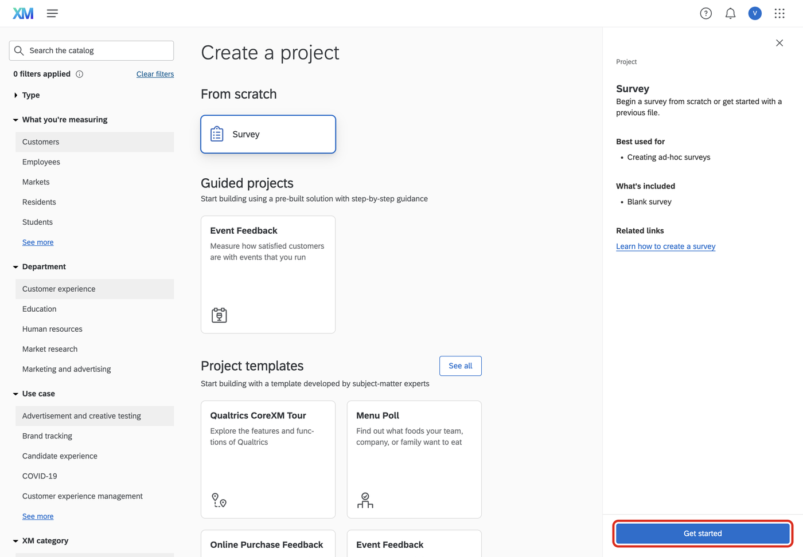
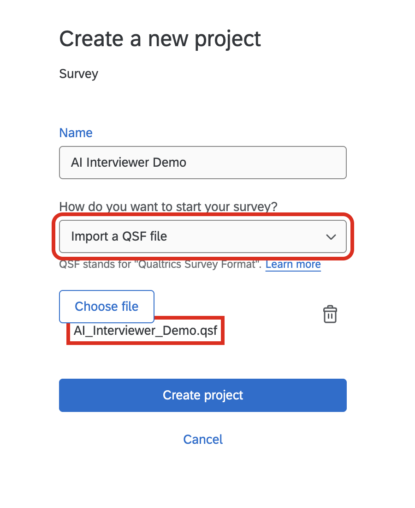
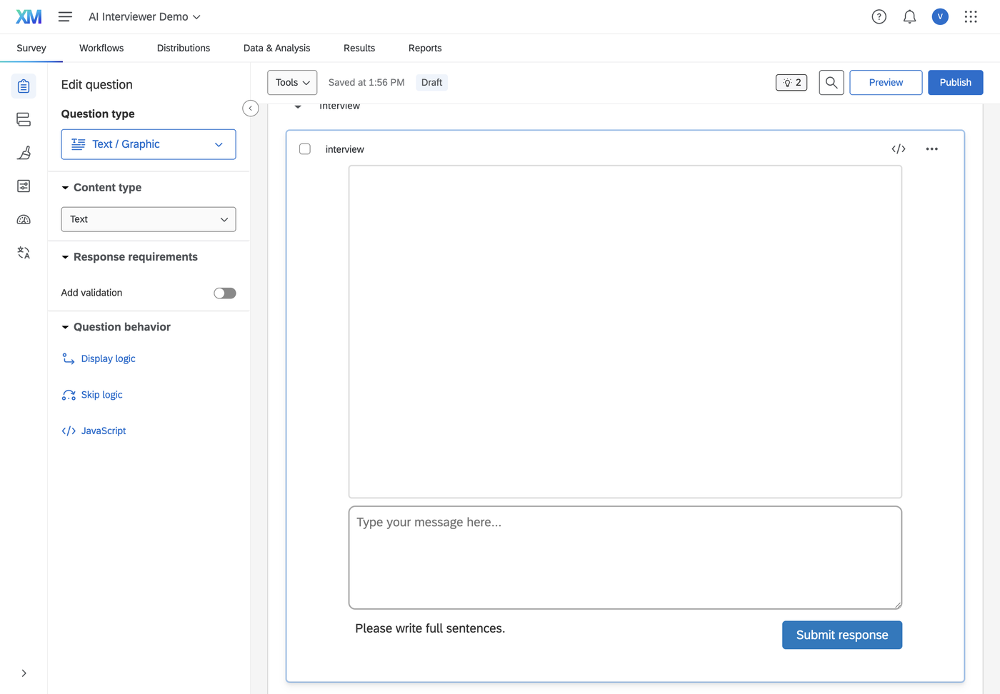
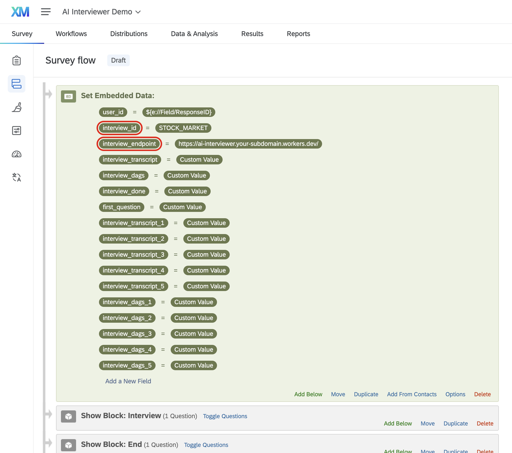
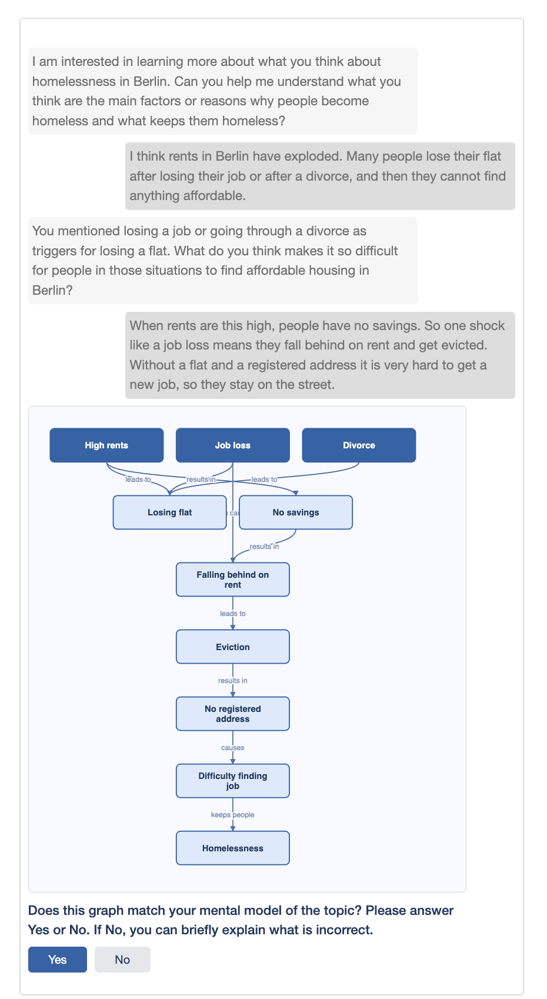

# 5. Put the interview into Qualtrics

[← Your own interview](4-own-interview.md) · [Overview](../../README.md) · [Next: Your data →](6-data.md)

You import a ready-made survey file and change two values. No copying of code.

## Step 1: Download the survey file

In your GitHub repository, open the folder `qualtrics/` and click one of these files:

| File | Respondents answer by |
|---|---|
| `AI_Interviewer_Demo.qsf` | typing |
| `AI_Interviewer_Demo_voice.qsf` | typing or speaking (needs `openai` or `gemini`) |

Click the **Download raw file** button (arrow pointing down, top right of the file).

## Step 2: Import it into Qualtrics

1. In Qualtrics, click **Create a project**, choose **Survey** under *From scratch*, and click **Get started**.

   

2. Give the survey a name. Under **How do you want to start your survey?** choose **Import a QSF file**, choose the downloaded file, and click **Create project**.

   

The survey opens. The question "interview" looks empty in the editor. That is normal: the chat appears only when the survey runs.

## Step 3: Point the survey at your interviewer

1. In the left bar, click **Survey flow** (second icon).
2. In the green box **Set Embedded Data**, click the value after `interview_endpoint` and replace it with your address from [chapter 2](2-deploy.md), for example `https://ai-interviewer.YOUR-SUBDOMAIN.workers.dev/`.
3. Click the value after `interview_id` and replace `STOCK_MARKET` with your interview's ID, for example `MY_STUDY`. Keep `STOCK_MARKET` for a first try.
4. Click **Apply** (bottom right).

Leave all other fields in the green box as they are. The interviewer writes its results into them.

## Step 4: Try it

Click **Preview** at the top of the editor. Answer the first question.

The picture shows the example `HOMELESS_BERLIN`. After the last question of a topic, the interviewer draws what the respondent said as a cause-and-effect graph and asks whether it is right. With **No**, the respondent can type a correction. Interviews without `[dag]`, like `STOCK_MARKET`, go straight to the next question.

## Step 5: Add your own questions and publish

- Add your other survey questions in new blocks **before or after** the block *Interview*. Do not change the question inside *Interview*.
- The next-page arrow stays visible during the interview. When the interview is over, the button in the chat says **End of interview**. Tell respondents in your instructions to click the arrow only then. The field `interview_done` shows later who finished ([chapter 6](6-data.md)).
- When everything works, click **Publish**.

## ✅ You should now see

In the preview, the first question of your interview, and a follow-up question after you answer.

## Something went wrong?

| Problem | What to do |
|---|---|
| The chat box stays empty | Check `interview_endpoint` in the survey flow. It must start with `https://` and be your exact address. Open the address in a browser: it must say `Running!`. |
| An error about an unknown interview | `interview_id` in the survey flow must match a file name in `src/interviews/` exactly. |
| "Create project" fails during import | Download the file again with **Download raw file**. Saving the page with the browser gives a file Qualtrics cannot read. |
| You built your survey already and only want the interview in it | Import the demo as a separate project and save its block *Interview* to your Qualtrics library. Insert that block into your survey from the library. Then add the same embedded data fields as in the demo's survey flow at the top of your survey flow. |

[Next: Get your data →](6-data.md)
