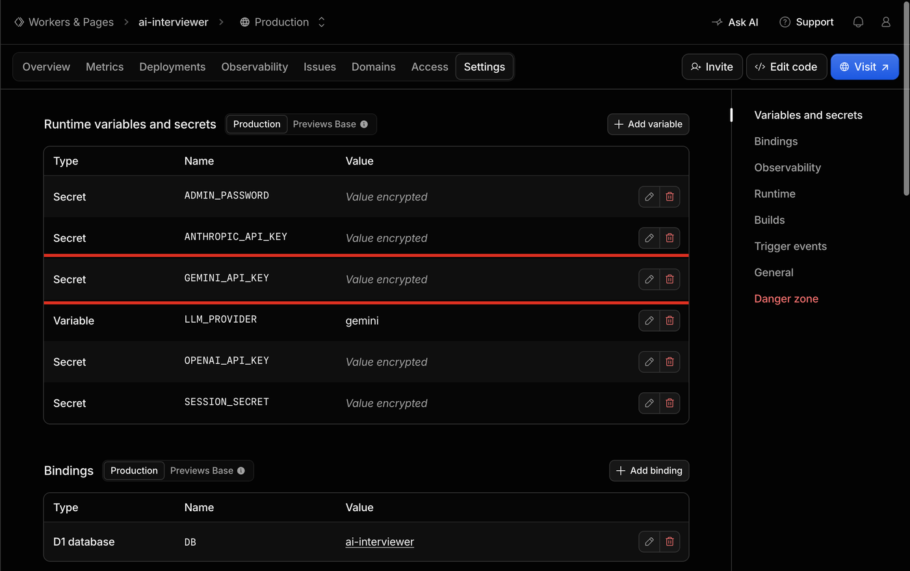

# 7. Help and questions

[← Your data](6-data.md) · [Overview](../../README.md)

## What does it cost?

- **Cloudflare**: nothing on the free plan. It allows 100,000 requests per day; each answer is one request.
- **GitHub**: nothing.
- **LLM provider**: you pay per use. As a rough guide, a 15-minute interview costs well under one cent with Gemini Flash-Lite and around 10 to 30 cents with GPT-4o. Longer interviews and the `[dag]` graphs cost more. Set a monthly spending limit with the provider ([chapter 1](1-what-you-need.md)).

## Change or rotate an API key

Do this if a key was shown to someone, stopped working, or you want to add `ADMIN_PASSWORD`.

1. Cloudflare dashboard → **Workers & Pages** → **ai-interviewer** → **Settings** → **Variables and secrets**.
2. Click the pencil next to the secret, paste the new value, and save. To add a secret, click **Add variable**, choose type **Secret**.
3. Delete the old key at the provider.

The change is live after a few seconds. Secrets stay when you later change interview files.

If `SESSION_SECRET` is `none`, changing the API key also ends interviews that are running at that moment. Those respondents have to start the interview again. Change keys when nobody is taking the survey, or set `SESSION_SECRET` to any long random text.

## Switch to a different LLM provider

`LLM_PROVIDER` lives in the file `wrangler.jsonc` of your GitHub repository. A change in the Cloudflare dashboard would be overwritten by the next commit.

1. Add the new provider's key as a secret (see above): `OPENAI_API_KEY`, `GEMINI_API_KEY` or `ANTHROPIC_API_KEY`.
2. On github.com, open `wrangler.jsonc`, click the pencil, and change the line `"LLM_PROVIDER": "..."` to `openai`, `gemini` or `claude`.
3. Commit to the main branch. The new version is live in 2 to 4 minutes.

If your interview files set a `model`, change it to a model of the new provider or remove the line.

## Privacy

- Answers go from the respondent's browser to your Cloudflare worker, then to the LLM provider. They are stored in Qualtrics and in your Cloudflare database. Nothing is sent to the authors of this project.
- Mention the LLM provider in your consent form and your ethics application.
- Ask respondents not to type names or other identifying details.
- Use a paid account with the LLM provider. Free tiers, for example Gemini's, may use your data to improve the provider's products.
- To delete all backup data, delete the D1 database `ai-interviewer` in Cloudflare. Interviews still run without it; only the backup and `/export` stop.

## Limits

- Voice answers do not work with `claude`. With `openai`, speech is transcribed as English.
- Some fixed texts are in English: the chat buttons and the question asking whether the graph is right. Everything in your interview file can be in any language.
- A Qualtrics field holds about 75,000 characters of transcript (five parts). The backup database has no such limit.
- One answer may be up to 5,000 characters long.

## Get updates from this project

Your repository is a copy, so it does not change by itself. To take a newer version, copy the changed files from [brandesdavid/llm-behavioral-interviewer](https://github.com/brandesdavid/llm-behavioral-interviewer) into your repository, or ask someone familiar with Git to merge them. Keep your own files in `src/interviews/` and your `wrangler.jsonc`.

## Still stuck?

Open the worker in Cloudflare, tab **Observability**, and repeat the failing step. The log shows the error the worker hit. Include that text when you ask for help in the [issue tracker](https://github.com/brandesdavid/llm-behavioral-interviewer/issues).
